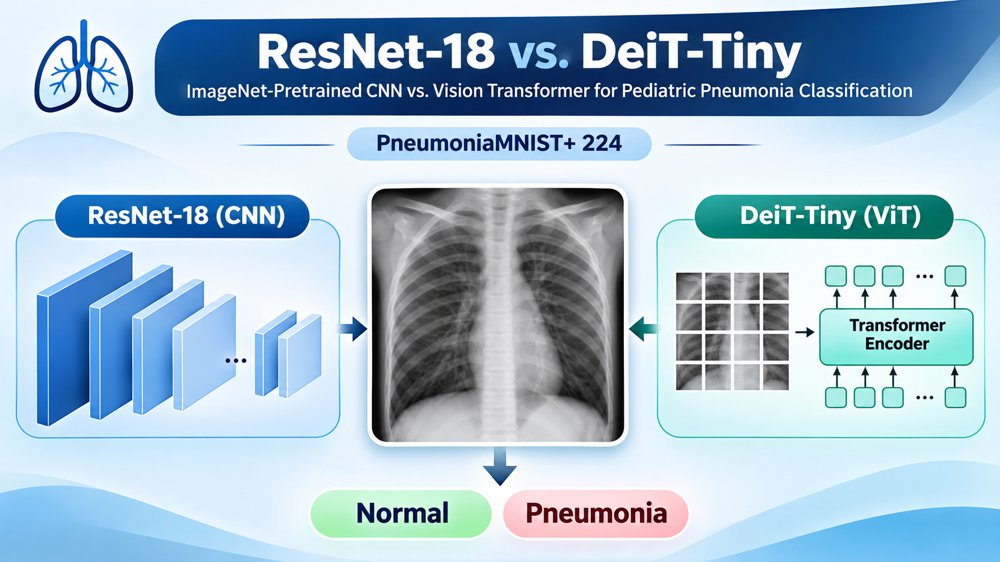
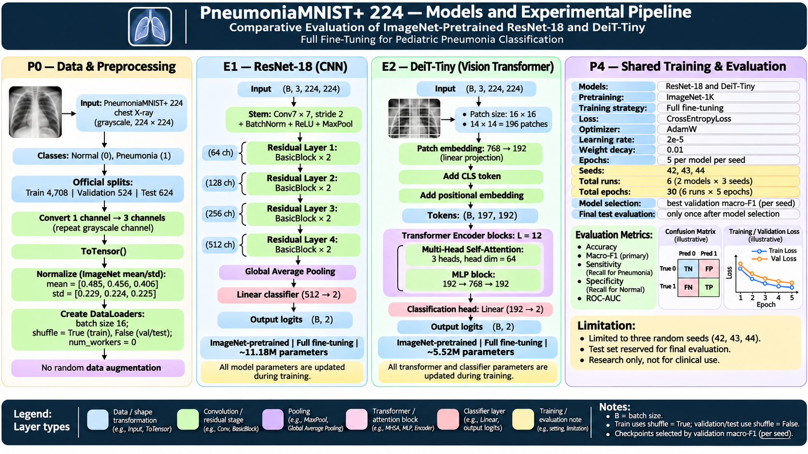

<p align="center">
  
</p>

# Comparative Evaluation of ImageNet-Pretrained ResNet-18 and DeiT-Tiny for Pediatric Pneumonia Classification

**An educational study of transfer learning and CNN–Vision Transformer performance on pediatric chest X-rays.**

**PyTorch · PneumoniaMNIST+ 224 · ResNet-18 · DeiT-Tiny · Full Fine-Tuning**

[Jupyter notebook](files/pneumoniamnist-cnn-transformer-uyentran.ipynb) · [Notebook (HTML)](files/pneumoniamnist-cnn-transformer-uyentran.html) · [Technical report (PDF)](files/pneumoniamnist_cnn_transformer_uyentran.pdf) · [Results](#results)

## Overview

This project compares an **ImageNet-pretrained CNN (ResNet-18)** and a **Vision Transformer (DeiT-Tiny)** for binary classification of pediatric chest X-ray images using **PneumoniaMNIST+ 224**. The aim is to examine how these pretrained models perform under the same full fine-tuning and evaluation protocol.

Each model is trained independently with three predefined random seeds (42, 43, 44), giving **six training runs**. The best checkpoint from each run is selected using validation macro-F1 and evaluated on the official held-out test set. The study reports classification metrics, variation across seeds, learning curves, and training time.

**Research question:** How do ImageNet-pretrained ResNet-18 and DeiT-Tiny compare in pediatric pneumonia classification performance and training time under a shared full fine-tuning protocol?

## Models and Experimental Pipeline

| Model | Architecture | Trainable parameters | `timm` model ID |
|---|---|---:|---|
| **E1 — ResNet-18** | Residual CNN with global average pooling | 11,177,538 | `resnet18.tv_in1k` |
| **E2 — DeiT-Tiny** | Vision Transformer with 16 × 16 patches, 12 encoder blocks, and 3 attention heads per block | 5,524,802 | `deit_tiny_patch16_224.fb_in1k` |

Both models start from ImageNet-1K pretrained weights. Their classification heads are configured for two classes—**Normal (0)** and **Pneumonia (1)**—and all model parameters are updated during fine-tuning. Each model receives tensors of shape `(B, 3, 224, 224)` and outputs two logits of shape `(B, 2)`. DeiT-Tiny processes 196 patch tokens plus one CLS token, each with an embedding dimension of 192; this study does not use knowledge distillation.



*Figure 1. Shared preprocessing, ResNet-18 and DeiT-Tiny architectures, and the training and evaluation procedure.*

## Dataset and Preprocessing

[PneumoniaMNIST+ 224](https://medmnist.com/) contains **5,856 grayscale pediatric chest X-ray images** at 224 × 224 resolution. The official dataset splits are used without creating new partitions.

| Split | Normal | Pneumonia | Total | Purpose |
|---|---:|---:|---:|---|
| Training | 1,214 | 3,494 | 4,708 | Update model weights |
| Validation | 135 | 389 | 524 | Select checkpoints |
| Test | 234 | 390 | 624 | Final evaluation only |

The same deterministic preprocessing is applied to all splits: convert grayscale images to three identical channels, apply `ToTensor()`, and normalize using ImageNet means `[0.485, 0.456, 0.406]` and standard deviations `[0.229, 0.224, 0.225]`. No random data augmentation, class reweighting, or model-specific preprocessing is used.

Pneumonia accounts for approximately **74.2%** of training and validation images, compared with **62.5%** of test images. These differences are considered when interpreting the results.

[Class distribution](images/class_distribution.png) · [Sample training X-rays](images/sample_xrays.png)

## Experimental Protocol

| Setting | Value |
|---|---|
| Models | ImageNet-pretrained ResNet-18 and DeiT-Tiny; full fine-tuning |
| Random seeds | 42, 43, 44 (three per model) |
| Training | 5 epochs per run; 6 runs total |
| Batch size | 16 |
| Loss | Unweighted cross-entropy |
| Optimizer | AdamW |
| Learning rate / weight decay | `2e-5` / `0.01` |
| Checkpoint selection | Highest validation macro-F1; earlier epoch retained on a tie |
| Primary test metric | Macro-F1 |
| Other test metrics | Accuracy, sensitivity, specificity, ROC-AUC |
| Reporting | Mean ± sample standard deviation across three seeds |

Every run starts with a fresh pretrained model, optimizer, and seed-controlled training DataLoader. The same fixed hyperparameters are used for both architectures, without a learning-rate search, early stopping, or model-specific tuning. The **test set is used only after checkpoint selection**, not to choose models or settings.

## Results

### Held-Out Test Performance

The following results are **mean ± sample SD across three seeds**, measured on the same official test set of 624 images.

| Metric | ResNet-18 | DeiT-Tiny |
|---|---:|---:|
| **Macro-F1 (primary)** | **0.9114 ± 0.0176** | **0.9121 ± 0.0119** |
| Accuracy | 0.9209 ± 0.0148 | 0.9215 ± 0.0100 |
| Sensitivity (Pneumonia recall) | 0.9974 ± 0.0000 | 0.9974 ± 0.0026 |
| Specificity (Normal recall) | 0.7934 ± 0.0395 | 0.7949 ± 0.0299 |
| ROC-AUC | 0.9907 ± 0.0027 | 0.9900 ± 0.0005 |

The mean test macro-F1 scores differ by only **0.0007** (0.07 percentage points). DeiT-Tiny scored higher for seed 42, while ResNet-18 scored higher for seeds 43 and 44. Neither model was consistently better across the three runs.

ResNet-18 had a higher mean best-validation macro-F1 (**0.9884** versus **0.9809**), but this difference did not translate into a clear test advantage. Recorded training times were similar: approximately **1.37 minutes per five-epoch run** for ResNet-18 and **1.36 minutes** for DeiT-Tiny on the tested Apple Silicon MPS setup. These timings are not an inference-speed benchmark.

### Learning Behavior and Classification Errors

[Training and validation loss curves](images/training_curves.png) · [Six confusion matrices](images/confusion_matrices.png)

ResNet-18 showed decreasing or stabilizing validation loss across all three seeds. DeiT-Tiny's validation loss increased in later epochs for seeds 42 and 44 while training loss continued to fall, suggesting possible overfitting in those runs.

Across the six test evaluations, there were **0–2 false negatives** (Pneumonia predicted as Normal) and **40–59 false positives** (Normal predicted as Pneumonia) per run. Both models therefore achieved high Pneumonia sensitivity but lower Normal specificity at the evaluated decision rule.

Detailed run-level results are available in [test_results_per_seed.csv](files/test_results_per_seed.csv) and [validation_summary.csv](files/validation_summary.csv).

## Interpretation and Limitations

Under the tested protocol, these two **pretrained model pipelines** achieved similar held-out test macro-F1 and recorded training times. This does not establish that CNNs and Vision Transformers are generally equivalent: the models also differ in parameter count, pretrained weights, and pretraining procedures.

The main limitations are:

- **Limited evaluation data:** All six runs use the same 624-image test set. Seed-level standard deviations are not confidence intervals for new patients or hospitals.
- **Dataset differences:** Class proportions and data provenance differ across the official splits; their contributions to the validation–test performance gap are not isolated.
- **Fixed training settings:** Five epochs and shared hyperparameters may not be optimal for either model.
- **Limited repetitions:** Three seeds offer only a small assessment of training variability; no significance or equivalence tests were performed.
- **No external validation:** The study does not establish clinical reliability or generalization to independent hospital datasets.

## Reproducibility

The experiment is implemented in a single Jupyter notebook with PyTorch, `timm`, and `medmnist`. The recorded environment used **Python 3.13.5**, **PyTorch 2.14.1**, **timm 1.0.31**, **MedMNIST 3.0.2**, and Apple Silicon MPS. Exact results may vary across environments.

```bash
git clone https://github.com/uyentran9/pneumoniamnist-cnn-transformer.git
cd pneumoniamnist-cnn-transformer

# Prepare output folders and the directory used by the current notebook to locate the project root.
mkdir -p notebooks data images results checkpoints

# Install the main dependencies.
python -m pip install torch torchvision timm medmnist numpy pandas matplotlib scikit-learn notebook

# Open the notebook.
jupyter notebook files/pneumoniamnist-cnn-transformer-uyentran.ipynb
```

Run **Parts 0–6 in order**. The current notebook locates the project root by looking for `notebooks/` and `data/` directories (the `notebooks/` folder can be empty because the notebook itself is stored in `files/`). The dataset and ImageNet-pretrained weights are downloaded when needed. Training creates six best-checkpoint files in `checkpoints/`, while CSVs and figures are saved in `results/` and `images/`. To run Part 5 without retraining, all six checkpoints must be available in `checkpoints/`.

The dataset and trained checkpoints do not need to be committed to GitHub; they can be downloaded or generated locally. The CSV files linked below document the reported results.

## Research Materials

| Resource | Contents |
|---|---|
| [Jupyter notebook](files/pneumoniamnist-cnn-transformer-uyentran.ipynb) · [HTML](files/pneumoniamnist-cnn-transformer-uyentran.html) | Code, explanations, and experiment outputs |
| [Technical report (PDF)](files/pneumoniamnist_cnn_transformer_uyentran.pdf) | Methods, results, discussion, and limitations |
| [Model and experimental pipeline](images/vision-transformer-pneumonia4.png) | Architecture and workflow diagram |
| [Training curves](images/training_curves.png) · [Confusion matrices](images/confusion_matrices.png) | Multi-seed learning behavior and test errors |
| [Test results by seed](files/test_results_per_seed.csv) · [Test summary](files/test_results_summary.csv) | Run-level test metrics and mean ± SD |
| [Validation results](files/validation_summary.csv) | Checkpoint selection, validation scores, and training times |

## References and Attribution

- He et al. (2016). [Deep Residual Learning for Image Recognition](https://doi.org/10.1109/CVPR.2016.90). *CVPR*.
- Touvron et al. (2021). [Training Data-Efficient Image Transformers & Distillation Through Attention](https://proceedings.mlr.press/v139/touvron21a.html). *ICML*.
- Kermany et al. (2018). [Identifying Medical Diagnoses and Treatable Diseases by Image-Based Deep Learning](https://doi.org/10.1016/j.cell.2018.02.010). *Cell*.
- Yang et al. (2023). [MedMNIST v2: A Large-Scale Lightweight Benchmark for 2D and 3D Biomedical Image Classification](https://doi.org/10.1038/s41597-022-01721-8). *Scientific Data*.
- [MedMNIST / MedMNIST+](https://github.com/MedMNIST/MedMNIST) · [PyTorch Image Models (`timm`)](https://github.com/huggingface/pytorch-image-models)

**Author:** Victoria Tran (My-Uyen Tran) · [Academic portfolio](https://uyentran9.github.io/uyentran-ai-blog/)

**Research-use notice:** This is an educational benchmark study, not a clinically validated diagnostic system. It should not be used for medical diagnosis or decision-making.
